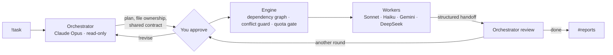

<div align="center">

# discord-ai-chatroom

[](LICENSE)
[](https://nodejs.org)
[](https://discord.js.org)
[](#configuration)

Turn a Discord server into a control room for the AI coding agents on your machine.<br>
An Orchestrator plans the work, a team of cheaper agents builds it, and you approve and review from Discord.

[Features](#features) • [Getting started](#getting-started) • [Usage](#usage) • [Configuration](#configuration) • [How it works](#how-it-works) • [Tiếng Việt](README.vi.md)

</div>

## Features

- **One request, a whole team**: Claude Opus (through [Claude Code](https://docs.claude.com/en/docs/claude-code)) breaks your request into tasks and assigns each one to the best-value agent: Claude Sonnet or Haiku, Gemini (through Antigravity), DeepSeek (through Codex).
- **You stay in control**: every plan waits for your approval; ask for changes with `!revise`.
- **Agents don't overwrite each other**: each task owns its files, tasks sharing a file are run one after another, real changes are measured and conflicts go back to the Orchestrator. Files are backed up before every task.
- **Agents talk through the Orchestrator**: shared contract, structured handoffs, and requests/questions the Orchestrator must resolve.
- **Quota-aware**: an agent out of quota pauses the job instead of failing it, and the job resumes by itself after the reset.
- **Built-in monitoring**: live dashboard, quota, health, activity and alert channels, created for you.
- **Works with what you have**: agent CLIs installed on the machine are detected automatically.

## Getting started

### Prerequisites

- [Node.js](https://nodejs.org) 22.13 or later
- [Claude Code](https://docs.claude.com/en/docs/claude-code) installed and logged in (`claude`): required, it runs the Orchestrator
- A Discord server where you can add a bot

Optional worker agents and tools:

| Tool | Adds | |
|---|---|---|
| [Antigravity](https://antigravity.google) (`agy`) | `gemini-flash` | UI, long context, research |
| [Codex CLI](https://github.com/openai/codex) (`codex`) with a `deepseek` provider | `deepseek-flash` | cheap coding and tests |
| [onWatch](https://github.com/onllm-dev/onwatch) | quota panel, quota-aware pausing | the bot keeps it running |

### Install

```bash
git clone https://github.com/LQLManZz/discord-ai-chatroom.git
cd discord-ai-chatroom
npm install
npm run setup
```

The setup wizard:

1. Asks for your language (`en` or `vi`).
2. Validates your bot token and prints an invite link for your server.
3. Asks for the lobby channel ID and your Discord user ID.
4. Detects the agent CLIs on your machine, writes `.env`, and runs a full check.

> [!TIP]
> Create the bot at <https://discord.com/developers/applications> → **Bot** → **Reset Token**, and turn on **Message Content Intent** on the same page. To copy IDs in Discord, enable **Settings → Advanced → Developer Mode**, then right-click a channel or your avatar.

### Run

```bash
npm start
```

On first start the bot builds the server layout around your lobby channel. Type `!help` there to get started.

| Category | Channels |
|---|---|
| **AI HUB** | your lobby for commands · `📥-reports`, your inbox: plans to approve, final reports, failures (you are @mentioned) |
| **MONITORING** | `📊-dashboard` · `📈-quota` · `🩺-health` · `🧾-activity` · `🚨-alerts` |
| **WORKSPACES** | one channel per project folder, one thread per job |

To keep the bot running in the background:

- **Windows**: `npm run autostart` starts it at logon with no window and restarts it after a crash.
- **macOS / Linux**: use a process manager, for example `pm2 start src/index.js --name ai-chatroom`.

> [!NOTE]
> Only one copy of the bot can run at a time. A second copy exits immediately instead of answering every command twice.

## Usage

```text
!task in ~/projects/shop: add a /health endpoint with a test
```

1. The Orchestrator reads the code and posts a plan in a new thread: tasks, owners, files, dependencies.
2. You press **Approve** (in the thread or in `#📥-reports`) or reply `!revise <feedback>`.
3. Workers run in parallel where possible and post their reports; the dashboard shows who is doing what.
4. The Orchestrator reviews the result, runs another round if needed, and sends the final report to `#📥-reports`.

| Command | Description |
|---|---|
| `!task <request>` | Start a job in the current workspace channel (the default workspace from the lobby) |
| `!task in <folder>: <request>` | Start a job in a specific folder; its channel is created if needed |
| `!revise <feedback>` · `!approve` · `!cancel` | Control the job of the current thread |
| `!resume [job]` | Retry a job paused for quota now |
| `!ask <agent> <question>` | Ask one agent directly |
| `!workspace [path]` | List workspaces, or add one and make it the default |
| `!autonomy [add\|remove <path>]` | Let agents run shell commands in a folder |
| `!files` · `!cat <file>` · `!diff` · `!run <command>` | Look into the channel's workspace |
| `!agents` · `!model <agent> <model>` · `!quota` · `!status` · `!jobs` · `!export` · `!clean` · `!hub` | System |

## Configuration

Settings live in `.env`, created by `npm run setup`. See [.env.example](.env.example) for the full list.

| Variable | Default | Description |
|---|---|---|
| `LANGUAGE` | `en` | Interface language, `en` or `vi`. Agents report in the same language unless `CHAT_LANGUAGE` is set |
| `ALLOWED_USER_IDS` | server owner | Users allowed to command the bot and approve plans |
| `WORKSPACE_DIR` | `./workspace` | Default folder agents work in |
| `AGENT_AUTONOMY` | `safe` | `safe`: agents edit files only. `full`: agents may also run shell commands |
| `FULL_AUTONOMY_DIRS` | `./workspace` | Folders that always run in `full` mode |
| `AGENTS_DISABLED` | | Agent keys to switch off even if their CLI is installed |
| `ORCHESTRATOR_MODEL`, `SONNET_MODEL`, … | `opus`, `sonnet`, … | Model per agent; `!model` changes it at runtime |
| `MAX_PARALLEL` / `MAX_ROUNDS` / `TASK_TIMEOUT_MIN` | `3` / `3` / `30` | Engine limits |
| `QUOTA_STOP_PCT` / `QUOTA_ALERT_PCT` | `2` / `10` | Pause an agent / alert you below this quota % (needs onWatch) |
| `REPORT_DM` | `0` | `1` also sends reports to you as a DM |

Agents, their CLIs and their skills are declared in [src/agents.js](src/agents.js). The Orchestrator picks agents from the `skills` text, so editing it changes how work is split.

> [!WARNING]
> Users in `ALLOWED_USER_IDS` can make agents edit files in your workspaces, and in full-autonomy folders run any shell command (`!run` included). Keep the list short and the bot on a private server.

## How it works



- Each agent is a headless CLI call (`claude -p`, `agy`, `codex exec`) in the workspace folder.
- Plans, reports, handoffs, backups and job state are saved in `<workspace>/.chatroom/jobs/<id>/`, so jobs survive a restart.
- Run `npm run doctor` any time to check your token, intent, permissions, agent CLIs and onWatch.

## Development

```bash
npm test          # engine, conflicts, quota pause/resume, i18n, with fake agents (no quota used)
npm run doctor    # environment check
npm run privacy   # scan the repository for secrets and personal data
```

Contributions are welcome, see [CONTRIBUTING.md](CONTRIBUTING.md).
