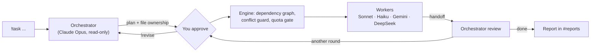

# discord-ai-chatroom

A Discord server that works as a hub for the AI coding agents already on your machine. An **Orchestrator** (Claude Opus via Claude Code) plans the work, splits it into tasks, hands them to cheaper **worker** agents (Claude Sonnet/Haiku, Gemini via Antigravity, DeepSeek via Codex), and reviews the result. You approve plans and get reports in Discord.

[Tiếng Việt](README.vi.md)

## Features

- **Plan → approve → execute → review** loop, with tasks run in parallel along a dependency graph.
- **No overwriting each other's work**: every task owns a set of files; tasks that share a file are serialized; the engine measures who actually changed what and flags conflicts to the Orchestrator. Files are backed up before each task.
- **Agents talk through the Orchestrator**: a shared contract, structured handoffs, and requests/questions/blockers the Orchestrator must resolve.
- **Quota-aware**: an agent out of quota pauses the job instead of failing it; progress is saved and the job resumes by itself after the reset (uses [onWatch](https://github.com/onllm-dev/onwatch) data when installed).
- **Survives restarts**: jobs are saved to disk and resume where they stopped.
- **Auto-detects agents**: only CLIs installed on the machine are offered to the Orchestrator.
- **English / Vietnamese** UI (`LANGUAGE=en|vi`).

## How it works



On first start the bot builds this layout around your lobby channel:

| Category | Channels |
|---|---|
| 🏢 AI HUB | your lobby (commands) · `📥-reports` — plans to approve, final reports, failures (you are @mentioned) |
| 📡 MONITORING | `📊-dashboard` agents & job progress · `📈-quota` AI quotas · `🩺-health` bot/CLIs/machine · `🧾-activity` event log · `🚨-alerts` conflicts, failures, low quota |
| 📁 WORKSPACES | one channel per project folder, one thread per job |

## Requirements

- Node.js **22.13+**
- [Claude Code](https://docs.claude.com/en/docs/claude-code) (`claude`), logged in — required for the Orchestrator
- Optional workers: [Antigravity](https://antigravity.google) (`agy`), [Codex CLI](https://github.com/openai/codex) (`codex`) with a `deepseek` provider in `~/.codex/config.toml`
- Optional: [onWatch](https://github.com/onllm-dev/onwatch) for the quota panel and quota-aware pausing
- A Discord server you control

## Quick start

```bash
git clone https://github.com/LQLManZz/discord-ai-chatroom.git
cd discord-ai-chatroom
npm install
npm run setup
npm start
```

`npm run setup` walks you through it:

1. Create an application at <https://discord.com/developers/applications> → **Bot** → **Reset Token**, and turn on **Message Content Intent**.
2. Paste the token; the wizard prints an invite link (Administrator) for your server.
3. Enable **Developer Mode** in Discord (Settings → Advanced), then paste the lobby channel ID and your user ID.
4. Pick the language and default workspace folder. The wizard detects your agent CLIs, writes `.env`, and runs `npm run doctor`.

Then type `!help` in the lobby.

## Commands

| Command | |
|---|---|
| `!task <request>` | Plan and run a job in the current workspace channel (or the default workspace from the lobby) |
| `!task in <folder>: <request>` | Run in a specific folder (creates its channel) |
| `!revise <feedback>` · `!approve` · `!cancel` | In a job thread; Approve/Cancel buttons also appear in `#reports` |
| `!resume [job]` | Retry a job paused for quota now instead of waiting for the reset |
| `!ask <agent> <question>` | Ask one agent directly |
| `!workspace [path]` | List workspaces, or add one and make it the default |
| `!autonomy [add\|remove <path>]` | Let agents run shell commands in a folder |
| `!files` · `!cat <file>` · `!diff` · `!run <cmd>` | Inspect the channel's workspace |
| `!agents` · `!model <agent> <model>` · `!quota` · `!status` · `!jobs` · `!export` · `!clean` · `!hub` | System |

## Configuration

Everything lives in `.env` (see [.env.example](.env.example)). The ones you are most likely to touch:

| Variable | Default | |
|---|---|---|
| `LANGUAGE` | `en` | UI language, `en` or `vi`; agents report in it too (`CHAT_LANGUAGE` overrides) |
| `ALLOWED_USER_IDS` | server owner | Who may command the bot and approve plans |
| `AGENT_AUTONOMY` / `FULL_AUTONOMY_DIRS` | `safe` / `./workspace` | `safe`: agents edit files only · `full`: agents may run shell commands |
| `AGENTS_DISABLED` | — | Agent keys to switch off even if installed |
| `*_MODEL` | `opus`, `sonnet`, … | Model per agent; also `!model` at runtime |
| `MAX_PARALLEL` · `MAX_ROUNDS` · `TASK_TIMEOUT_MIN` | `3` · `3` · `30` | Engine limits |
| `QUOTA_STOP_PCT` · `QUOTA_ALERT_PCT` | `2` · `10` | Pause an agent / alert below this % (onWatch) |
| `REPORT_DM` | `0` | Also DM you reports |

Agents and their skills are defined in [src/agents.js](src/agents.js); the Orchestrator assigns work from the `skills` text.

## Keep it running

- **Windows**: `npm run autostart` registers a logon task that runs the bot with no window and restarts it if it crashes (`scripts/autostart.ps1 -Remove` to undo). Logs: `.chatroom/bot.log`.
- **macOS / Linux**: use any process manager, e.g. `pm2 start src/index.js --name ai-chatroom`.

Only one copy can run at a time (a second one exits immediately).

## Development

```bash
npm test         # engine, conflicts, quota pause/resume, i18n — fake agents, no quota used
npm run doctor   # check .env, Discord token/intent/permissions, agent CLIs, onWatch
```

Job artifacts (plans, reports, handoffs, backups, state) are written to `<workspace>/.chatroom/jobs/<id>/`.

## Security

- Anyone in `ALLOWED_USER_IDS` can make agents edit files in your workspaces, and in **full autonomy** folders run arbitrary shell commands (`!run` included). Keep that list short and the bot in a private server.
- The bot reads its token from `.env`; never commit it (it is git-ignored).
